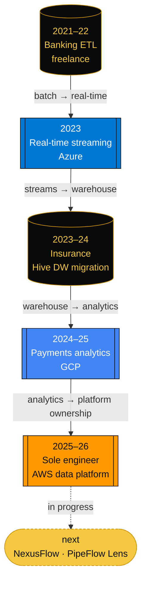

<div align="center">


**🍍 Senior Data Engineer · 5+ years · Hyderabad, India**<br/>
Batch, streaming and lakehouse pipelines in production on **Azure, AWS and GCP**.

[](https://www.linkedin.com/in/vamsi-krishna-pineapple/)
[](https://vamsi-krishna.autos/)
[](mailto:nukalavamsikrishna10@gmail.com)

</div>

---

## 🍍 `SELECT` the engineer

```sql
SELECT * FROM engineers WHERE name = 'vamsi';
```

```text
┌────────────┬────────────────────────────────────┐
│ column     │ value                              │
├────────────┼────────────────────────────────────┤
│ name       │ Vamsi Krishna                      │
│ role       │ Senior Data Engineer               │
│ experience │ 5+ years                           │
│ location   │ Hyderabad, India (IST)             │
│ clouds     │ Azure | AWS | GCP  (production)    │
│ engines    │ PySpark, Kafka, Airflow            │
│ lakehouse  │ Delta Lake on ADLS Gen2            │
│ latest     │ sole engineer, AWS data platform   │
│ certs      │ AZ-900 (held)                      │
│ certs_wip  │ Databricks DE, GCP Professional DE │
│ building   │ NexusFlow, PipeFlow Lens           │
└────────────┴────────────────────────────────────┘
(1 row)   -- \x on: one engineer, expanded display
```

---

## 🗺️ Multi-Cloud Rosetta Stone

> Same job, three dialects. Every cell is a service I've run in production.

| Responsibility |  |  |  |
|:--|:--|:--|:--|
| **Land** | ADLS Gen2 | Glue jobs | BigQuery |
| **Compute** | Databricks · PySpark | Glue · PySpark | Dataproc · PySpark |
| **Stream** | Kafka → Databricks | — | — |
| **Orchestrate** | ADF | Step Functions | Composer (Airflow) |
| **Serve** | Delta Lake tables | Athena | BigQuery · Bigtable |
| **Secrets** | — | Secrets Manager | — |
| **Observe** | ADF monitoring | CloudWatch | — |

<sub>— means I haven't owned that layer on that cloud in production. No filler.</sub>

---

## 🧬 Career lineage

> Read it like a lineage graph: each role is a dataset derived from the one before it.



<sub>🟦 Azure · 🟧 AWS · 🔵 GCP · ⬛ Spark/Hive/SQL core · 🟨 in progress</sub>

---

## 🛰️ Run board

> Last known state of my public pipelines. Numbers come straight from each repo's code or benchmark docs.

<table>
<tr>
<td width="50%" valign="top">

**🟢 [`pyspark-scd-framework`](https://github.com/thevamsikrishna/pyspark-scd-framework)**<br/>
SCD Type 1/2 on Delta Lake: SHA-256 change detection, two-phase MERGE, soft deletes, late-arriving quarantine.

```text
bench   10M rows · SCD2 · 800K changes
took    6.2 min  (DBR 14.3, 4 workers)
tuned   3.9 min  (AQE + broadcast dims)
zorder  4,200+ files → 180
scan    48s → 3.2s
```

`PySpark` `Delta Lake` `Databricks`

</td>
<td width="50%" valign="top">

**🟢 [`dynamic-pyspark-etl`](https://github.com/thevamsikrishna/dynamic-pyspark-etl)**<br/>
YAML is the contract: ADF triggers a Databricks job, the engine reads sources, joins, maps, runs DQ, and writes Delta with an audit trail.

```yaml
target:
  format: delta
  mode: merge
  merge: { keys: [customer_id] }
# DQ: not_null | unique | row_count_min | sql
```

`PySpark` `YAML` `ADF` `Delta Lake`<br/>
[](https://github.com/thevamsikrishna/dynamic-pyspark-etl/actions/workflows/ci.yml)

</td>
</tr>
<tr>
<td width="50%" valign="top">

**🟢 [`bigquery-bigtable-pipeline`](https://github.com/thevamsikrishna/bigquery-bigtable-pipeline)**<br/>
BigQuery → Bigtable with two engines behind one config, pluggable row-key strategies, and a dead-letter table.

```text
engine  beam (Dataflow) | spark (Dataproc)
keys    composite | hash_prefix | reversed_ts
batch   1,000 mutations per write
guard   row key ≤ 4 KB, else rejected
dlq     bad rows → BigQuery table
```

`BigQuery` `Bigtable` `Apache Beam` `PySpark` `Terraform`

</td>
<td width="50%" valign="top">

**🟢 [`adf-regression-automation`](https://github.com/thevamsikrishna/adf-regression-automation)**<br/>
Regression gate for ADF: after deploy, a Databricks job validates pipeline output and writes results to audit tables.

```text
flow    GH Actions → ADF → Databricks
checks  row_count(±tol%) · schema
        nulls · duplicates · reconcile
audit   Azure SQL → HTML report
alert   Logic Apps
```

`ADF` `Databricks` `PySpark` `GitHub Actions`<br/>
[](https://github.com/thevamsikrishna/adf-regression-automation/actions/workflows/adf-regression-ci-cd.yml)

</td>
</tr>
<tr>
<td width="50%" valign="top">

**🟢 [`awesome-data-engineer-prep`](https://github.com/thevamsikrishna/awesome-data-engineer-prep)**<br/>
An open study guide for data engineering interviews, from fundamentals to end-to-end projects.

```text
guides  140 markdown files
cloud   33 · projects 27 · sql 23
other   interview 15 · fundamentals 14
        modeling 10 · pyspark 9
```

`SQL` `PySpark` `Data Modeling` `System Design`

</td>
<td width="50%" valign="top">

**🟡 `nexusflow` · `pipeflow-lens`** <sub>(running)</sub><br/>
Two builds in progress, not public yet.

```text
nexusflow      real-time fraud detection
               Kafka + Spark
pipeflow-lens  cost & carbon tracking
               per pipeline run
```

`Kafka` `Spark Streaming` `FinOps`

</td>
</tr>
</table>

---

## 🧑‍⚖️ Design decisions I'd defend in a review

<details>
<summary><b>Why a SHA-256 row hash for change detection instead of comparing columns?</b></summary>
<br/>

In [`hash_generator.py`](https://github.com/thevamsikrishna/pyspark-scd-framework/blob/main/src/scd/hash_generator.py), the tracked columns are sorted, cast to string, null-coalesced to a `"NULL"` sentinel, joined with `|~|`, and passed to Spark's native `sha2(…, 256)`. With that, the MERGE condition compares one column instead of N.

- **Sorted columns:** reordering the YAML can't change the hash.
- **NULL sentinel:** `NULL` and `''` hash differently, and a null never makes the whole hash null.
- **`|~|` separator:** `"ab" + "c"` and `"a" + "bc"` don't collide.
- **Native `sha2`, no UDF:** it's a narrow transformation with no shuffle. The benchmark doc lists 10M rows × 8 columns hashed in 31s.

What it costs: you store a 64-char column per row, and you have to recompute history if the tracked column list changes. I'd accept both to get MERGEs that stay cheap and never fire on timestamp-only noise.
</details>

<details>
<summary><b>Why does SCD2 expire first and append second, instead of one MERGE?</b></summary>
<br/>

A plain Delta MERGE can't update a matched row *and* insert its replacement for the same key. So [`scd_type2.py`](https://github.com/thevamsikrishna/pyspark-scd-framework/blob/main/src/scd/scd_type2.py) does it in two phases:

1. MERGE: close out the active rows whose hash changed (`effective_end_date`, `is_current = 0`) and soft-delete flagged rows.
2. Append: insert the new versions with fresh surrogate keys.

In the 10M-row benchmark, phase 1 took 2.1 min, phase 2 took 4.1 min, and ZORDER runs afterwards so it doesn't block either.
</details>

<details>
<summary><b>How do you pick a Bigtable row key?</b></summary>
<br/>

I pick it from the access pattern. [`row_key_strategy.py`](https://github.com/thevamsikrishna/bigquery-bigtable-pipeline/blob/main/src/common/row_key_strategy.py) has three strategies, chosen from config by a factory:

| Strategy | Shape | Use it when |
|:--|:--|:--|
| Composite | `{f1}#{f2}#{ts_bucket}` | High-cardinality entity + time-range scans |
| Hash prefix | `{md5[:4]}#{id}#{ts}` | Sequential IDs would hotspot one tablet; 4 hex chars give 65,536 prefixes |
| Reversed TS | `{MAXLONG - ts_ms}#{id}` | Newest-first reads (latest events) |

The guard rail is in code: any key over 4 KB raises `RowKeyError`, so an oversized key fails the run instead of quietly slowing Bigtable down.
</details>

<details>
<summary><b>Why YAML-driven pipelines instead of notebooks?</b></summary>
<br/>

Without a contract, every new source turns into a copy-pasted notebook with client-specific `if`s. In [`dynamic-pyspark-etl`](https://github.com/thevamsikrishna/dynamic-pyspark-etl), the YAML is that contract:

- ADF passes only `env` and `pipeline`. Paths resolve from `${env.storage.*}`, and watermarks from `${runtime.watermark}`.
- Joins, filters, broadcast hints, select expressions, DQ rules and the Delta merge keys are all declared in the YAML. The engine code stays the same for every pipeline.
- CI parses every YAML under `configs/` on each PR, so a broken config fails review instead of failing at 2 a.m.

The risk is that YAML turns into a bad programming language. The escape hatch is plain Spark SQL: `select` takes expressions, and DQ has a `sql` rule type, so the schema stays small.
</details>

<details>
<summary><b>Spark or Beam for BigQuery → Bigtable?</b></summary>
<br/>

Both, behind one config. The repo's rule of thumb:

- **Beam on Dataflow** for loads under ~1 TB and streaming deltas. Workers autoscale, you pay per vCPU-second, and bad records go to a side output → BigQuery DLQ.
- **PySpark on Dataproc** for full loads over ~1 TB, or when a cluster is already running. It writes through `foreachPartition` with one Bigtable client per partition, not per row.

The default is Beam, and you switch to Spark when Dataflow cost stops making sense at that volume. Row-key logic sits in `src/common`, so both engines produce identical keys.
</details>

---

## 📊 Telemetry

<div align="center">

<picture>
  <source media="(prefers-color-scheme: dark)" srcset="https://github-readme-stats.vercel.app/api?username=thevamsikrishna&show_icons=true&include_all_commits=true&count_private=true&hide_border=false&border_color=C9920A&title_color=F5C842&icon_color=C9920A&text_color=E6E6E6&bg_color=0A0A0A"/>
  
</picture>
<picture>
  <source media="(prefers-color-scheme: dark)" srcset="https://streak-stats.demolab.com?user=thevamsikrishna&background=0A0A0A&border=C9920A&ring=F5C842&fire=C9920A&currStreakLabel=F5C842&sideLabels=C9920A&currStreakNum=FFFFFF&sideNums=FFFFFF&dates=AAAAAA&stroke=C9920A"/>
  
</picture>

</div>

### 🗂️ Backlog

```text
$ backlog --owner vamsi --sort priority

ID      PRI  STATE         TASK
DE-101  P1   IN_PROGRESS   NexusFlow: real-time fraud detection (Kafka + Spark)
DE-102  P1   IN_PROGRESS   PipeFlow Lens: pipeline cost & carbon tracking
DE-103  P2   IN_PROGRESS   Databricks Certified Data Engineer
DE-104  P2   IN_PROGRESS   Google Cloud Professional Data Engineer
DE-100  --   DONE          AZ-900 Azure Fundamentals

5 tasks · 4 open · 1 done
```

---

```console
vamsi@hyderabad:~$ pipeline status
🍍 clouds=azure,aws,gcp  building=2  certs=1/3  tz=IST
   ping → nukalavamsikrishna10@gmail.com
```

<div align="center">

</div>
