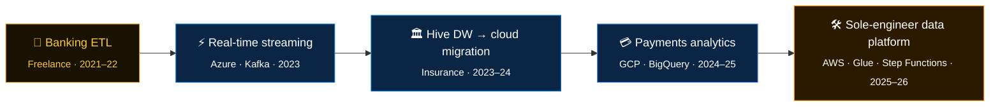

<div align="center">


[](https://git.io/typing-svg)

[](https://www.linkedin.com/in/vamsi-krishna-pineapple/)
[](https://vamsi-krishna.autos/)
[](mailto:nukalavamsikrishna10@gmail.com)


</div>

---

## 🍍 `SELECT * FROM engineers WHERE name = 'vamsi';`

```sql
-- 1 row returned · 0.003s · partition pruned ✓
┌──────────────────┬──────────────────────────────────────────────────────────────┐
│ column           │ value                                                        │
├──────────────────┼──────────────────────────────────────────────────────────────┤
│ role             │ Senior Data Engineer · 5+ yrs · Hyderabad, India             │
│ clouds_shipped   │ Azure ▸ AWS ▸ GCP   (production work on all three)           │
│ compute          │ PySpark · Databricks · Glue · Dataproc · Apache Beam         │
│ storage          │ Delta Lake · ADLS Gen2 · S3 · BigQuery · Bigtable            │
│ streaming        │ Kafka · Structured Streaming                                 │
│ orchestration    │ ADF · Airflow · Step Functions                               │
│ domains          │ banking · insurance · payments · enterprise IT               │
│ obsessions       │ idempotency, schema drift, cost per GB, boring on-call       │
│ certs            │ AZ-900 (held) · Databricks DE, GCP PDE (in progress)         │
│ open_to          │ Senior DE roles at product companies                         │
└──────────────────┴──────────────────────────────────────────────────────────────┘
```

---

## 🛂 &nbsp;The Multi-Cloud Rosetta Stone

> Most engineers know one cloud. I've shipped the **same pipeline patterns** on all three, so I think in *responsibilities*, not vendor names.

<div align="center">

| Responsibility |  |  |  |
|:---|:---:|:---:|:---:|
| 🪣 Land raw data | ADLS Gen2 | S3 | GCS |
| ⚙️ Distributed compute | Databricks | Glue | Dataproc · Dataflow |
| 🧭 Orchestrate | ADF | Step Functions | Composer (Airflow) |
| 🗄️ Serve / query | Delta · Synapse | Athena | BigQuery · Bigtable |
| 🔐 Secrets | Key Vault | Secrets Manager | Secret Manager |
| 📟 Observe | Azure Monitor | CloudWatch | Cloud Monitoring |

</div>

<sub>Every cell above is a service I've used in production or in a repo below.</sub>

---

## 🧬 &nbsp;Career Lineage

> Rendered as a data lineage graph, because that's how I see it: each engagement is an upstream dependency of the next.



---

## 🍍 &nbsp;Pipelines in Production

> Styled as an orchestrator's run board. Every number below comes from the repo itself.

<table width="100%">
<tr>
<td width="50%" valign="top">

#### 🟢 [`pyspark-scd-framework`](https://github.com/thevamsikrishna/pyspark-scd-framework)
**SCD Type 1 / 2 engine on Delta Lake**

SHA-256 change detection over tracked columns, two-phase Type 2 merges (expire → insert), YAML-configured dimensions, unit + integration tests.

```text
benchmark  100M rows · 10M changed
baseline   28.6 min
+AQE+ZORDER+Photon   11.8 min  (−59%)
```

`PySpark` `Delta Lake` `CDC` `Databricks`

</td>
<td width="50%" valign="top">

#### 🟢 [`dynamic-pyspark-etl`](https://github.com/thevamsikrishna/dynamic-pyspark-etl)
**Config-as-pipeline ETL framework**

Describe a pipeline in YAML (source, joins, transforms, DQ checks, target) and the engine runs it. Dev/QA/prod configs, audit tables, ADF + Databricks Jobs wiring, CI.

```yaml
quality:
  - type: not_null
  - type: unique
  - type: row_count_min
```

`PySpark` `YAML` `ADF` `Databricks Jobs`

</td>
</tr>
<tr>
<td width="50%" valign="top">

#### 🟢 [`bigquery-bigtable-pipeline`](https://github.com/thevamsikrishna/bigquery-bigtable-pipeline)
**BigQuery → Bigtable, built twice**

Same pipeline in PySpark *and* Apache Beam/Dataflow. Pluggable row-key strategies: composite, hash-prefix (anti-hotspot) and reversed-timestamp (latest-first scans).

`BigQuery` `Bigtable` `Beam` `Dataflow` `PySpark`

</td>
<td width="50%" valign="top">

#### 🟢 [`adf-regression-automation`](https://github.com/thevamsikrishna/adf-regression-automation)
**Regression testing for ADF pipelines**

Runs pipeline suites, validates row counts, schema and data quality, renders HTML reports, logs to audit tables and notifies via Logic Apps.

[](https://github.com/thevamsikrishna/adf-regression-automation/actions)

`ADF` `Databricks` `Logic Apps` `GitHub Actions`

</td>
</tr>
<tr>
<td colspan="2" valign="top">

#### 📚 [`awesome-data-engineer-prep`](https://github.com/thevamsikrishna/awesome-data-engineer-prep)
**140+ study notes for data engineering interviews**: SQL from basics to recursive CTEs, PySpark internals and skew handling, data modeling, multi-cloud, and real-world case studies (ride-sharing, fintech, log analytics).

 

</td>
</tr>
</table>

---

## 🧠 &nbsp;Design Decisions I'd Defend in a Review

<details>
<summary><b>Why hash rows instead of comparing columns in SCD merges?</b></summary>
<br/>
One <code>sha2(concat_ws(...), 256)</code> per row turns an N-column comparison into a single equality check, keeps the merge condition readable, and makes "what changed?" auditable. Hashing 10M rows over 8 columns takes ~31s, which is cheap next to the merge itself.
</details>

<details>
<summary><b>Why three row-key strategies for Bigtable?</b></summary>
<br/>
Because the right key depends on the read pattern. Sequential IDs hotspot a single tablet, so a <b>hash prefix</b> spreads writes. "Latest event first" reads want a <b>reversed timestamp</b>. Multi-attribute lookups want a <b>composite</b> key. Making it pluggable means the schema decision stays in config, not code.
</details>

<details>
<summary><b>Why YAML-driven pipelines?</b></summary>
<br/>
Hardcoded PySpark turns every new feed into a code review. A declarative config makes pipelines diffable, reviewable by analysts, promotable across dev → QA → prod, and forces data-quality checks to be written down instead of remembered.
</details>

<details>
<summary><b>Why build the same pipeline in Spark <i>and</i> Beam?</b></summary>
<br/>
To learn where each one actually wins: Spark for heavy joins on a cluster you already pay for, Beam/Dataflow for autoscaling and unified batch + streaming semantics. Now I can pick based on evidence instead of habit.
</details>

---

## 📟 &nbsp;Telemetry

<div align="center">


[](https://git.io/streak-stats)

</div>

---

## 🗺️ &nbsp;Backlog

```text
STATUS    TASK
───────   ──────────────────────────────────────────────────────────
🔄 WIP    NexusFlow · real-time fraud detection on Kafka + Spark
🔄 WIP    PipeFlow Lens · cost & carbon tracking per pipeline run
🔄 WIP    Databricks Data Engineer certification
🔄 WIP    Google Cloud Professional Data Engineer certification
📋 NEXT   First upstream PR to Delta Lake or Apache Spark
📋 NEXT   Weekly LinkedIn deep-dives on pipeline internals
```

---

<div align="center">

```text
$ vamsi --status
✔ pipelines healthy   ✔ schemas validated   ✔ open to senior DE roles
```

*Building in public. One idempotent pipeline at a time.* 🍍


</div>
